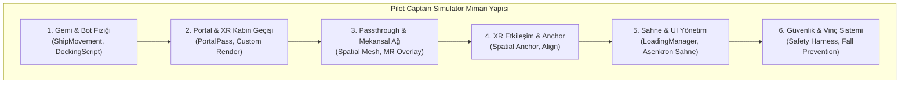

# Pilot Captain Simulator (STAJ22001)

Bu depo, **Kırklareli Üniversitesi Yazılım Mühendisliği Bölümü** bünyesinde yürütülen **STAJ22001-STAJ22002** kodlu Mesleki Staj kapsamında **Rafora Bilişim** bünyesinde geliştirilen **Kılavuz Kaptan Transfer Simülasyonu (Pilot Captain Simulator)** projesinin kaynak kodlarını ve mimari bileşenlerini içermektedir.

---

## 📌 Proje Özeti
**Pilot Captain Simulator**, kılavuz kaptanların açık denizde seyir halindeki konteyner gemisine pilot botuyla yanaşması, fiziki alan ile sanal ortamın harmanlanması ve çarmıh merdiveni üzerinden gemiye intikalini simüle eden yüksek gerçeklikli bir **Karma Gerçeklik (Mixed Reality - MR / VR)** eğitim platformudur.

Proje, kılavuz kaptan adaylarının zorlu deniz koşullarında güvenli, tekrarlanabilir ve riskten arındırılmış bir ortamda operasyonel eğitim almalarını hedefler.

---

## 🏗️ Proje Mimarisi ve Modüller

Proje, olay güdümlü (event-driven) ve modüler tasarım ilkelerine uygun olarak 6 ana blok halinde yapılandırılmıştır:



1. **Gemi / Bot Fiziği & Yanaşma Modülü:** Pilot botunun ve konteyner gemisinin açık deniz dinamiklerini, dalga tepkilerini ve güvenli yanaşma sınırlarını (`DockingScript.cs`) simüle eder.
2. **Portal & XR Kabin Geçiş Modülü:** Kursiyerin sanal pilot botu kabininden passthrough (gerçek oda) ortamına pürüzsüz geçişini sağlayan portal maskeleme ve shader entegrasyonu.
3. **Mekansal Ağ & Passthrough Modülü:** Meta Quest 3 sensörleri ile fiziksel ortamın taranması, yüzeylerin ağ (mesh) olarak modellenmesi ve sanal objelerle örtüştürülmesi.
4. **XR Etkileşim & Spatial Anchor:** Sanal bot ve çarmıh merdiveninin fiziksel odaya milimetrik hassasiyetle sabitlenmesi (Spatial Anchor hizalaması).
5. **Sahne & UI Yönetimi (`LoadingManager.cs`):** İki aşamalı asenkron sahne yükleme ve prefab havuzu yönetimi ile FPS düşüşlerini (frame drop) engelleyen altyapı.
6. **Güvenlik & Vinç Sistemi:** Merdiven tırmanma sırasında düşme algılama ve otomatik vinç/halat kilitleme mekanizması.

---

## 🛠️ Kullanılan Teknolojiler & Donanım

- **Oyun Motoru:** Unity 6 / Unity 2022+ (High Definition Render Pipeline - HDRP)
- **XR SDK:** Meta XR Core SDK, OpenXR Plugin, XR Interaction Toolkit (XRI)
- **Programlama Dili:** C# (.NET Standard)
- **Hedef Donanım:** Meta Quest 3 / Meta Quest Pro (PC-VR Link / Air Link)
- **Geliştirme Ortamı:** JetBrains Rider / Visual Studio

---

## 🚀 Kurulum ve Çalıştırma

1. Projeyi yerel makinenize klonlayın:
   ```bash
   git clone https://github.com/TunahanYavuz/STAJ22001-STAJ22001.git
   ```
2. **Unity Hub** uygulamasını açın ve projeyi `Add project from disk` seçeneğiyle ekleyin (HDRP ve XR paketlerinin yüklenmesini bekleyin).
3. `Assets/Sahneler` (veya `Assets/Scenes`) altındaki ana simülasyon sahnesini açın.
4. Meta Quest 3 başlığınızı Link kablosu veya Air Link ile bağlayın ve Unity Editor üzerinden `Play` butonuna basarak simülasyonu başlatın.

---

## 👤 Geliştirici Bilgileri

- **Öğrenci:** Tunahan Yavuz
- **Öğrenci No:** 1230505063
- **Bölüm:** Kırklareli Üniversitesi - Yazılım Mühendisliği (3. Sınıf)
- **Ders Kodu:** STAJ22001-STAJ22002 - Mesleki Staj
- **Firma:** Rafora Bilişim

---

## 📄 Lisans ve Telif Hakları
Bu depo yalnızca eğitim ve staj değerlendirme amaçlı hazırlanmıştır. Proje içerisindeki tüm ticari ve lisanslı üçüncü parti kütüphaneler telif haklarına uygun olarak depodan arındırılmıştır.
